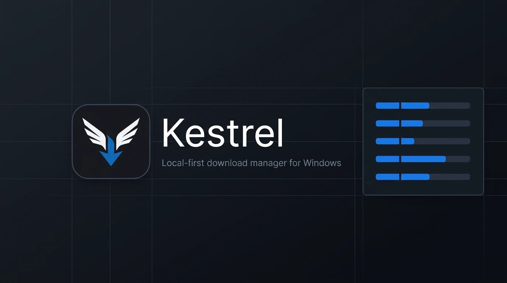

<p align="center">
  
</p>

# Kestrel

A fast, local-first download manager for Windows 10/11 built with **Rust + Tauri v2**, **Svelte 5**, and a **Manifest V3** browser extension.

## Features

- **Multi-Connection HTTP/HTTPS Engine**: Pre-allocated zero-merge file writing (`seek_write`), dynamic chunk splitting with work-stealing, and pause/resume persistence.
- **Media & Torrent Support**: Video/audio downloads via `yt-dlp` + `ffmpeg`, and magnet/torrent downloads via `librqbit`.
- **Browser Integration (`Kestrel Bridge`)**: Intercepts downloads in Brave/Chromium, prompts for confirmation and save location, forwards cookies/headers, and refreshes expired links automatically.
- **Automation & Post-Processing**: Smart folder routing (regex/extension/domain), SHA-256/MD5 checksum verification, archive extraction (`7z`), bandwidth limiter, and process-aware auto-throttle.
- **Low Overhead**: Destroys the WebView on window close while staying active in the Windows System Tray, with optional minimized autostart.
- **Local-First Storage**: No database, no login, no telemetry. All state is stored locally in `settings.toml`, `history.json`, and `active/*.meta.json` using atomic file writes.

---

## Installation (Windows)

1. Download `Kestrel_0.1.1_x64-setup.exe` from the **Releases** page.
2. Run the installer. If Windows SmartScreen warns about an unrecognized publisher, click **More info** then **Run anyway**.

### Browser Extension Setup (Optional)

1. Download or extract the `extension/` folder.
2. Open `brave://extensions` or `chrome://extensions` and enable **Developer mode**.
3. Click **Load unpacked** and select the `extension/` folder.
4. Open **Settings** in Kestrel, copy the **Local pairing token**, and paste it into the extension popup.

---

## Building from Source

### Prerequisites

- **Windows 10/11** (WebView2 is included on modern Windows)
- **Node.js** (v20+)
- **Rust** (`rustup`)
- **Visual Studio C++ Build Tools** (Desktop development with C++)

### 1. Add Sidecar Binaries

`src-tauri/binaries/*.exe` is excluded from Git because `ffmpeg` exceeds GitHub's 100 MB file limit. Before building, place these three Windows x64 binaries inside `src-tauri/binaries/`:

- `yt-dlp-x86_64-pc-windows-msvc.exe`
- `ffmpeg-x86_64-pc-windows-msvc.exe`
- `7z-x86_64-pc-windows-msvc.exe`

### 2. Install Dependencies & Run

```powershell
npm install
npm run tauri dev
```

> On Windows PowerShell with restricted script execution policy, use `npm.cmd` instead of `npm`.

### 3. Build Installer

```powershell
npm run tauri build
```

The NSIS installer will be generated at:
`src-tauri/target/release/bundle/nsis/Kestrel_0.1.0_x64-setup.exe`

### 4. Checks & Tests

```powershell
npm run check
cd src-tauri
cargo check
cargo clippy --all-targets -- -D warnings
cargo test
```

---

## Project Structure

- `src/`: Svelte 5 + TypeScript frontend
- `src-tauri/`: Rust backend, download engines, localhost bridge (`127.0.0.1`), and Tauri setup
- `extension/`: Manifest V3 browser extension for Brave/Chromium
- `public/`: Static assets and app logo
